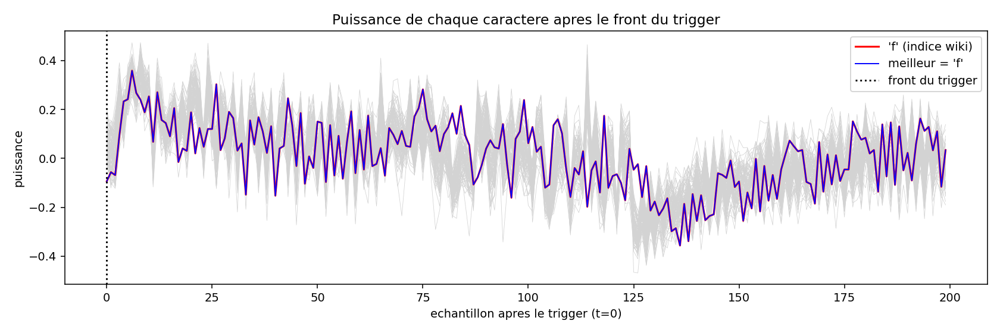
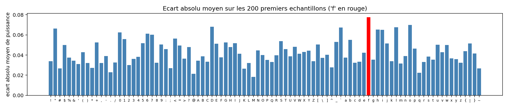
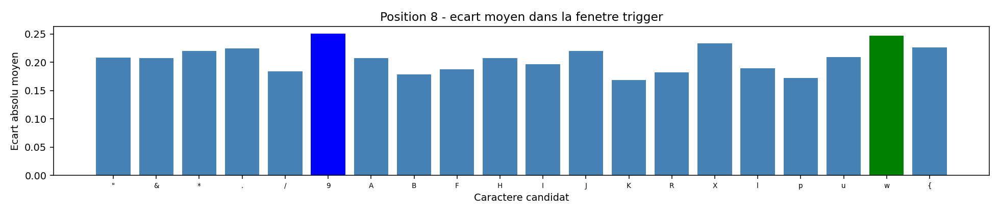

# Security project

## A. Project objectives
The goal of this project is to find a secret and a password, both hashed, contained in Arduino firmware.

The materials we used were:
- Arduino UNO board
- ChipWhisperer card (used to perform side-channel attacks and fault injections during the labs)
- An ELF file that we had to flash onto the Arduino
- Our good old computer
- Resistors, capacitors, and cables
  
The options are quite wide, but taking into account that we mostly worked on hardware attacks during the labs, we can therefore deduce that this way of proceeding should be preferred.

## B. Before it gets serious
The first thing I did while going through this project was to take the easy way: try to find the source code from the .elf file that was given as a starting point. First, I tried a website, which gave me the strings but couldn't find the entire code. But our good old Mr. Claude (Claude Sonnet 5.5) found a way to translate the .elf into source code (.cpp) super fast.

For sure, this wasn't a good idea if I wanted to be surprised when finding the secret. But as I couldn't resist, let's not be blind: this may (for sure) have introduced a certain bias into the way I viewed the project. That's why a small mention of this is important.

-> Let's pretend this didn't happen
-> The source code Claude gave me can be found in the repo. (Version of the code retrieved by Claude Sonnet 5.5)

## C. First steps into the project

### 1. PulseView
First, as a hardware-attack check, I wanted to see if there was any communication on several pins while resetting the Arduino. To do this, I used the PulseView software. I found communication on pin 11 at reset time. The most probable hypothesis was that this was UART communication, with pin 11 as TX.

In the image above, we can see the packet sent by pin 11.

### 2. Finding the RX pin

By using another Arduino UNO, I connected the serial interface to the UART. This helped me identify which pin was RX. When I connected the TX pin of the interface Arduino to pin 10 of the Arduino we wanted to crack, the RX LED blinked when I tried to send messages. This was a nice gift from the Arduino, as it confirmed the hypothesis of a UART connection on pins 10 (RX) and 11 (TX).

The way I proceeded in both cases was by trial and error with every pin on the board.
I could also have worked with a simple converter, but I don't have one at home, so I used an Arduino.

-> Not really interesting, but the Arduino file for the interface can be found in the repo, in the arduino_interface folder.

The trigger pin (13) was also found using PulseView, by analyzing the response while communicating with the Arduino and entering codes in the terminal (during the first communications).

### 3. The adapted wiring

To perform power analysis, we need to access the power consumption of the board. We need to put the ChipWhisperer probe between the digital power supply and ground. We also need to put in a resistor that will serve as a shunt.

    ATmega side (microcontroller on the Arduino PCB):

    -> Reset pin (pin 1), connected to the reset pin of the PCB
    -> As we deduced before, the UART pins on the PCB were pins 10 and 11. Those pins correspond to pins 16 and 17 on the ATmega.
    -> The trigger pin also changes: pin 13 on the PCB corresponds to pin 19 on the ATmega.
    -> We measure the voltage at the input on pin 7.
    -> Pins 9 and 10 are linked to the external clock of the PCB

    ChipWhisperer side:

    -> The probe pin is connected to pin 7 of the Arduino
    -> Ground and VCC are connected to the breadboard. The Arduino and ChipWhisperer share a common ground, but a voltage divider is used between the two VCC lines.
    -> TIO1 and TIO2 are used as UART
    -> TIO4 is used as the input trigger pin

    Arduino PCB side:

    -> Ground and VCC are connected to the breadboard
    -> The reset button is connected (reset pin)
    -> The trigger is connected to pin 19 of the PCB, to visualize the exchanged messages on the LED.
    -> Pins 9 and 10 are linked to the external clock of the PCB

 -> Final wiring:
 

NB: We also had to desolder the measurement-pin link between the ChipWhisperer and its target, and put the target in high-impedance mode to avoid perturbing the measurements. (The Python script I used to put the target in high impedance can be found in the high_imp folder.)

### 4. Baud rate calculation

We now want to determine the baud rate for clean communication.

Using the code in baud_rate, we figured out that the baud rate is 9600, which is logical if we take a look at the source code.

## D. Power analysis 

### 1. For password length

After hours spent trying to find the length of the password and still getting the same results, I figured out that maybe the length doesn't matter, and the Arduino only looks at the first characters. This was a good intuition (or maybe a logical thing after 4 hours). This phase can be skipped because it is not necessary. But the code and results can be found in the password_lenght folder. We can therefore see that, as we always get close but different results, what we get only depends on the noise.

### 2. For the password characters

This stage combines three signals: the trigger, the power measurement, and
the UART response. They have different roles: the trigger gives a timing
reference, the power trace reflects activity inside the microcontroller, and
the UART response reports the firmware's decision.

At the physical level, a microcontroller does not consume exactly the same
current during every instruction. In CMOS logic, transistors draw dynamic
current as internal capacitances are charged and discharged. A simplified
model is

`P_dynamic ≈ α · C · V² · f`

where `α` represents switching activity, `C` the effective capacitance, `V`
the supply voltage, and `f` the clock frequency. The measured voltage across
the current-sense path therefore changes with the processor's activity. It
also contains unrelated contributions from other instructions, peripherals,
the clock, and measurement noise; it is not a direct reading of the password
or of a single instruction.

Consequently, different guesses can make the processor follow different
instruction paths and perform different amounts of work. If a guess matches a longer prefix,
the comparison can proceed further before it exits. Those small execution
differences may change the power trace. The trigger helps compare traces from
a consistent point in time, but it does not itself reveal which character is
correct.

The script in `password_find/password_first.py` tests printable ASCII
characters from `!` to `~`, averaging 15 captures per candidate. The
sequential search in `password_find/password_full.py` starts from the
presumed prefix `f` and uses up to 30 captures per candidate. Averaging can
reduce random variation, but it cannot remove all noise or make a trace
unique to a character. The power score is therefore a way to rank candidates,
not proof of a match. The UART response `ACCESS GRANTED` confirms that the
complete candidate is correct.

### 3. Deeper analysis of the graphs

The first plot overlays the candidate traces after aligning them on the
trigger. Physically, each curve is a time-varying measurement related to the
target's current consumption; its peaks and dips reflect switching activity
as well as noise. The traces are not expected to look like a clean digital
code: many operations happen close together, and unrelated activity
contributes to the same measurement.

Sample 0 corresponds to the trigger edge. The gray curves show each
candidate's averaged trace; the red curve is `f`, and the blue curve is the
highest-scoring candidate. Their substantial overlap is a reminder that
small physical differences are difficult to distinguish from noise by eye.

To summarize those curves, the script calculates the mean absolute deviation
of each candidate's averaged trace from the average trace across all
candidates, over the first 200 samples after the trigger. A large score means
that a candidate's averaged trace differs more from the group in this window. It does not
directly measure how many password characters matched, nor does it establish
that the difference was caused by the comparison rather than by residual
variation.

The position-by-position plots show this limitation in the sequential
search. At the final position, the power score ranks `9` above `w`, but the
target's UART response confirms `w`. This is a useful example of the
difference between a physical side-channel observation and a confirmed
firmware result: the power trace suggests candidates, while the UART
acceptance message settles the decision.

Overall, the measurement is an indirect and noisy consequence of switching
activity inside the processor. Trigger alignment makes comparisons more
meaningful, and averaging reduces some random variation, but neither
technique turns the power score into a direct measurement of the secret. In
this experiment, power analysis guides the search; the target's UART response
confirms the result.

## F. The Secret
### 1. Before decryption
### 2. How to decrypt it
## G. Conclusion
